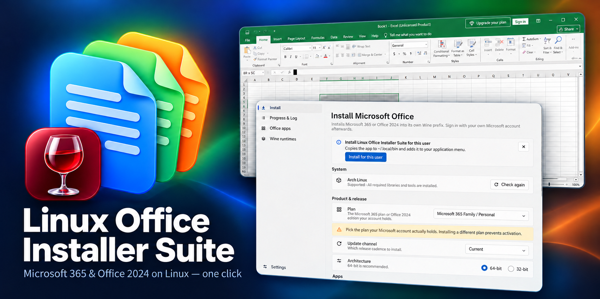
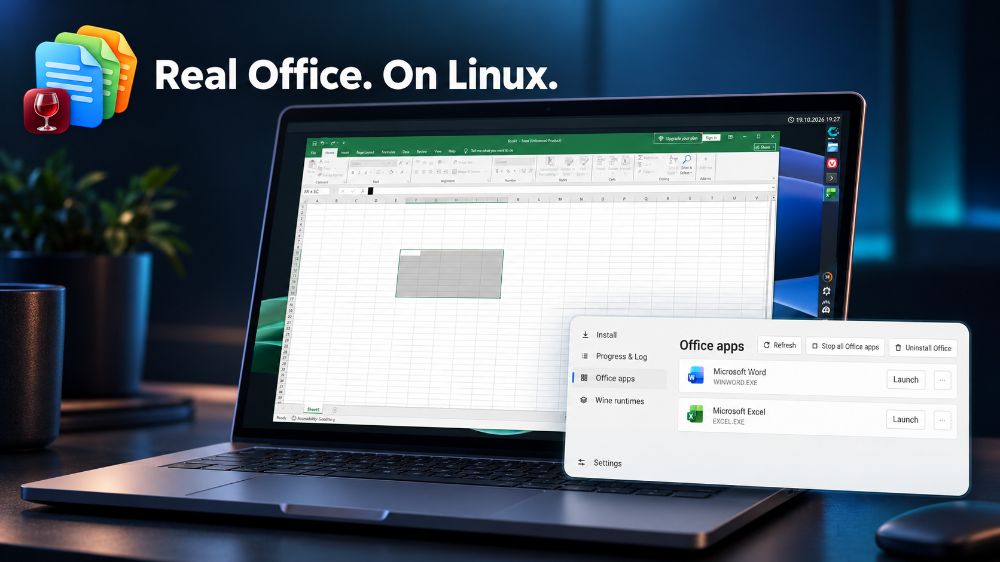
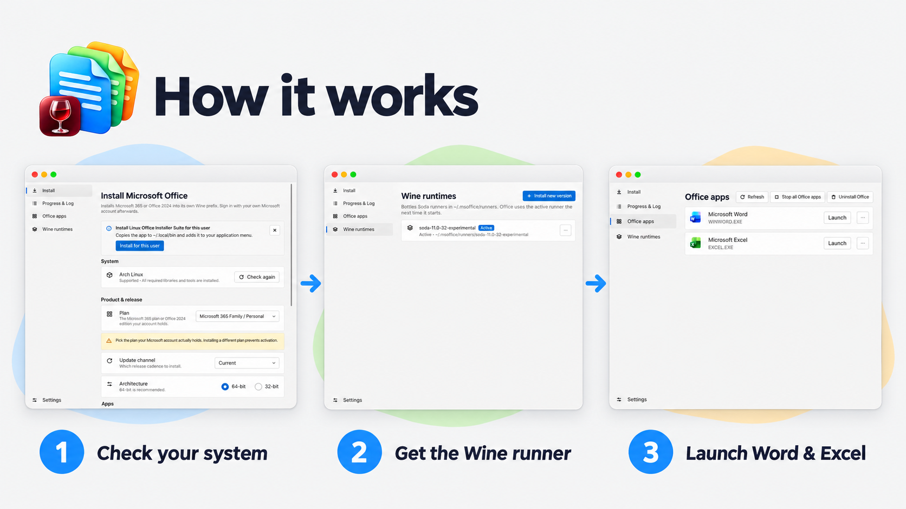

# Linux Office Installer Suite



> [!WARNING]
> **Experimental project. Not ready for production.**
> Expect bugs and breaking changes. Don't rely on it for work you can't afford to lose.

A one-click installer for **Microsoft 365** and **Office 2024** on Linux, for people who already own an Office license. It is a single Rust binary with a [Slint](https://slint.dev) interface that runs directly on your system.



## How it works



1. Checks your distro and installs the 64-bit and 32-bit libraries Wine needs.
2. Downloads and verifies a [Bottles Soda](https://github.com/bottlesdevs/wine) Wine runner.
3. Builds a Wine prefix based on the Bottles Microsoft 365 recipe.
4. Downloads Office from Microsoft's CDN with the official Office Deployment Tool.
5. Creates desktop launchers, icons and file associations for every Office app.

Everything lives under `~/.msoffice/`. Files written elsewhere (launchers, icons, settings) are recorded so they can be removed cleanly.

## Supported distributions

| Family | Status |
| --- | --- |
| Arch (Arch, CachyOS, Manjaro, EndeavourOS) | Tested |
| Fedora (Fedora, Nobara) | Untested |
| Debian (Debian, Ubuntu, Mint, Pop!_OS) | Untested |
| Others | Lists the missing libraries for you to install |

Contributions welcomes!

Enable 32-bit packages first: `[multilib]` on Arch, or `dpkg --add-architecture i386` on Debian/Ubuntu.

## Building

```sh
cargo build --release
```

Requires Rust, `pkgconf`, `fontconfig`, `libxkbcommon` and `libx11` development files.

## Legal note

- No Microsoft binaries are shipped. Every Microsoft component is downloaded at install time and checked against a pinned checksum.
- No product keys, KMS or activation bypass. Sign in with the Microsoft account that holds your license.
- Microsoft, Microsoft 365, Office, Word and Excel are trademarks of Microsoft Corporation. This project is not affiliated with or endorsed by Microsoft.

## Thanks

This project would not be possible without the **[Bottles](https://usebottles.com) team**. Their [Soda Wine runner](https://github.com/bottlesdevs/wine) runs Office, and their [Microsoft 365 installer recipe](https://github.com/bottlesdevs/programs) is the basis for the prefix setup. Known Office issues under Soda are tracked in [bottlesdevs/programs#500](https://github.com/bottlesdevs/programs/issues/500). Thank you!
